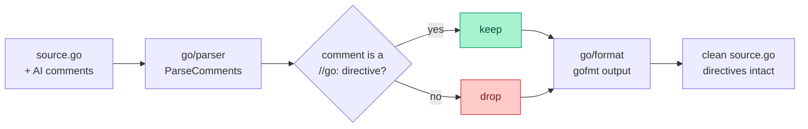

<p align="center">
  
</p>

<h1 align="center">stripcomments</h1>

<p align="center">
  <b>Tired of dropping the AI comments by hand?</b><br>
  Say goodbye to useless comments — keep the code, sweep the noise.
</p>

---

Every AI-generated file arrives buried in `// this function does X` narration.
`stripcomments` parses Go with the standard `go/parser`, drops every comment,
and re-emits gofmt-formatted output — in one command. Compiler and tool
**directives** are preserved, because removing them silently breaks builds or
ships empty values:

- `//go:build` / `// +build` constraints
- `//go:embed` (populates the variable below it)
- `//go:generate`, `//go:linkname`, and any other `//go:` directive

String and raw-string literals that happen to contain `//` or `/* */` are left
untouched — only real comments are removed.

## How it works



**Before → after:**

```go
// UserID uniquely identifies a user.   ← swept
// It is generated at signup.           ← swept
//go:generate stringer -type=Role       ← kept
func NewUser() {}                        // returns nothing  ← swept
```

```go
//go:generate stringer -type=Role
func NewUser() {}
```

## Install

```sh
go install github.com/cristian-sima/stripcomments/cmd/stripcomments@latest
```

## CLI

Overwrites each named file in place:

```sh
stripcomments path/to/file.go another.go
```

## Library

```go
import "github.com/cristian-sima/stripcomments"

// StripComments returns gofmt-formatted source with comments removed.
out, err := stripcomments.StripComments(src)

// StripFile overwrites a file in place, preserving its mode.
err := stripcomments.StripFile("path/to/file.go")
```

## Strip a whole tree

```sh
find . -name '*.go' -not -path './vendor/*' -print0 \
  | xargs -0 stripcomments
```

## License

MIT — see [LICENSE](LICENSE).
