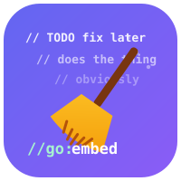
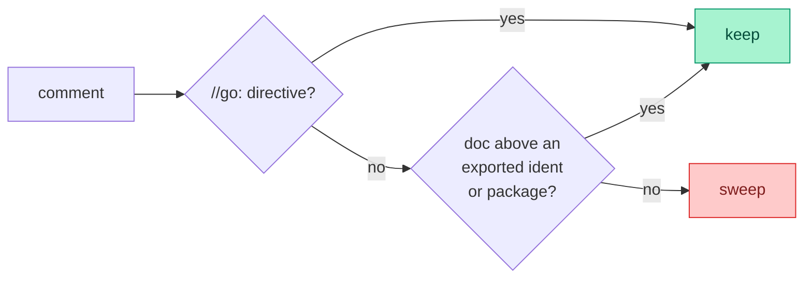

<p align="center">
  
</p>

<h1 align="center">stripcomments</h1>

<p align="center">
  <b>Tired of dropping the AI comments by hand?</b><br>
  Say goodbye to useless comments — keep the code, sweep the noise.
</p>

---

Every AI-generated file arrives buried in `// this function does X` narration.
`stripcomments` parses Go with the standard `go/parser`, sweeps that noise, and
re-emits gofmt-formatted output — in one command.

It keeps the comments that carry meaning:

- **Directives** — `//go:embed`, `//go:generate`, `//go:build`, `//go:linkname`,
  the legacy `// +build`. Always kept; removing them breaks builds or ships
  empty values.
- **Exported doc** — the doc block above every exported func, type, const, var,
  and exported struct field / interface method. Kept by default (that's your
  real API documentation).
- **Package doc** — the `// Package ...` block. Kept by default.

Everything else is swept: body comments, trailing inline notes, floating
comments detached by a blank line, and docs on unexported identifiers. String
and raw-string literals containing `//` or `/* */` are left untouched.

Want a truly bare file? `-drop-exported` and `-drop-package` remove those too.

## What gets kept vs swept (defaults)



**Before → after** (default run):

```go
// Package bank handles payments.        ← kept (package doc)
package bank

// Charge runs the payment.              ← kept (exported doc)
// It retries on failure.                ← kept (same block)
//go:generate stringer -type=Role        ← kept (directive)
func Charge() {                          // entry point   ← swept (trailing)
	// warm the cache                    ← swept (body)
	warm()
}

// helper is internal.                   ← swept (unexported doc)
func helper() {}
```

```go
// Package bank handles payments.
package bank

// Charge runs the payment.
// It retries on failure.
//go:generate stringer -type=Role
func Charge() {
	warm()
}

func helper() {}
```

## Install

```sh
go install github.com/cristian-sima/stripcomments/cmd/stripcomments@latest
```

## CLI

Overwrites each named file in place:

```sh
stripcomments path/to/file.go another.go
```

Flags (must come before the file arguments):

| Flag | Effect |
|---|---|
| `-drop-exported` | also strip doc comments above exported identifiers |
| `-drop-package` | also strip the `// Package ...` doc |

```sh
stripcomments -drop-exported -drop-package path/to/file.go
```

## Library

```go
import "github.com/cristian-sima/stripcomments"

// Default: keeps directives, exported doc, and package doc.
out, err := stripcomments.StripComments(src)

// Opt out to strip those too.
out, err := stripcomments.StripComments(src, stripcomments.DropExported(), stripcomments.DropPackage())

// StripFile overwrites a file in place, preserving its mode. Same options.
err := stripcomments.StripFile("path/to/file.go")
```

## Strip a whole tree

```sh
find . -name '*.go' -not -path './vendor/*' -print0 \
  | xargs -0 stripcomments
```

## License

MIT — see [LICENSE](LICENSE).
